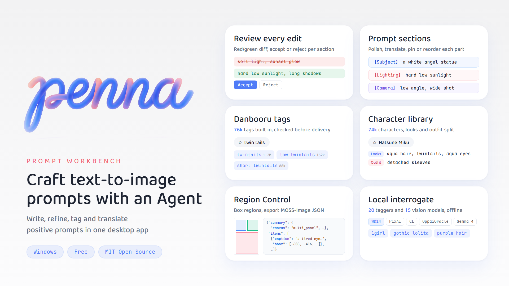

<p align="center">
  
</p>

<p align="center"><b>Penna</b> · A text-to-image prompt workbench for Windows</p>

<p align="center"><b>English</b> · <a href="README.md">简体中文</a></p>

<p align="center">
  
  
  
  
</p>

---

Penna is a tool for writing **positive prompts** for text-to-image models. It covers the whole process: drafting, editing, polishing and translating.

The window has two columns: the draft on the left and the Agent chat on the right. Every change the Agent makes arrives as a pending change and **is written into the draft only after you accept it**.

The interface is available in English, 简体中文, 繁體中文 and 日本語, with a dark mode.

<p align="center">
  
</p>

## Contents

- [Features](#features)
- [Getting started](#getting-started)
- [Data and privacy](#data-and-privacy)
- [Development](#development)
- [Repository layout](#repository-layout)
- [Acknowledgements](#acknowledgements)
- [License](#license)

## Features

### Draft and review

Results from the Agent and from Polish are submitted as pending changes. Changes are shown line by line as a red/green diff and can be accepted or rejected section by section; the draft is read-only while changes are pending. When the draft is empty, new content goes straight in.

### Sections

The draft is split into sections by labels at the start of a line, such as 【Subject】 or 【Lighting】. Each section is shown in its own colored box and can carry a line of translation (in the interface language). The **Final prompt** used for delivery strips the labels and translations automatically.

- Each section can be copied, polished, translated, pinned or deleted on its own, or taken into the chat to discuss with the Agent.
- Sections can be dragged to reorder or turned back into plain text; selected plain text can become a new section.
- Right-click a section label to rename it.
- **Merge** turns all sections on a page back into one continuous block of text.
- When the Agent changes only a few sections, it proposes changes to those sections and keeps the rest as they are.

### Pinned area

Selected text or whole sections can be pinned. The pinned area is read-only for Polish and the Agent, and can be dragged anywhere in the draft.

### Pages and series

A workspace holds up to 10 pages. Each page is a separate prompt, and pages can be grouped into series.

- Pages in the same series share one conversation, and the Agent can refer to the other pages in the series; series are independent of each other.
- One Agent reply can write several pages at once and starts a new series automatically when the topic changes.
- Double-click a page tab or series name to rename it. Pages can be reordered or moved out of a series, and a whole series can be saved to the Archive at once.

### Agent chat

- Replies stream in and can be stopped or run again at any time.
- Messages sent while a reply is generating are queued and sent in order; a queued message can also skip the line and be sent right away.
- Questions from the Agent appear as stacked options with single or multiple choice; when the choice is about sections of the draft, the sections of the current page are listed directly.
- When asked for tag interrogation or a specific local model, the Agent runs the model on this PC against the image in the chat; when the model is not installed yet, you choose whether to download it or use an installed one instead.
- When asked to turn the draft into JSON or lay it out by position, the Agent hands the task to the Region Control Agent. The finished layout appears in Region Control, and the JSON is also placed into a new series in the draft.
- Images (up to 10 MB) and text files can be attached with the button, by drag and drop, or with Ctrl+V.
- Type `@` to cite a Skill. Quick actions above the input box append to what you have typed and can be customized.
- Several conversations sit side by side as tabs; closed conversations stay in History.
- Each Preset has its own system prompt, temperature and Top P.

### Local Interrogate

Drop in an image and a model turns it back into tags or a prompt. There are three kinds:

- **Tag Interrogate**: 20 built-in ONNX taggers in four families (WD14, PixAI, CL and OppaiOracle) produce Danbooru tags. Character and general tags each have their own threshold, and results are re-filtered instantly when it changes. Tags in the result can be toggled one by one and are all selected by default.
- **NL Interrogate**: 15 built-in vision models, covering Gemma 4 (E2B to 31B), Gemma 4 Heretic, ToriiGate, JoyCaption and Florence-2, each with a choice of quantization. GGUF models run on llama.cpp, and a running server can be added to API Management for the Agent and Polish to use. Florence-2 runs inside the app and outputs tags, captions at several levels of detail, or a composition analysis.
- **LLM Analysis**: pick one or two enabled models from API Management; they interrogate at the same time and the results are shown side by side for comparison. The writing style follows the current Preset.
- With **Compress large images** on, large images are shrunk and converted to WebP when added.
- Both kinds of models are grouped by family; families and models can be dragged to reorder.
- Models and runtimes download from HuggingFace or a mirror, with resumable downloads and integrity checks. Gated models use the HuggingFace token from Settings.
- **Settings → Local Interrogate** can add model folders. Folders are searched with their subfolders for existing models (compatible with the folder layouts of BooruDatasetTagManagerPlus, NLapt and the HuggingFace cache), and the models found are used directly. The llama.cpp runtime, run options and captioning instructions are set here as well.
- Captioning instructions can be saved like Presets: keep several, name them and switch at any time.
- Results can be copied, sent to the Agent or put into the draft.

### Region Control

Draw regions on a canvas and describe each one to produce MOSS-Image layout JSON, with a separate layout chat on the right. Layouts can be saved to the Region Control section of the Archive and reopen in Region Control.

- Layouts are organized into series and pages, and the Agent starts a new series when the topic changes.
- Regions are listed as layers (foreground, middle ground, background) and dragged to reorder; one-, two- and three-point perspective guides are available.
- When the reference image and the canvas differ in orientation, the canvas can swap width and height to match; layouts the Agent writes at another aspect ratio are scaled proportionally into the center of the canvas.

### Danbooru tags

- About 76,000 common tags built in, with post counts and Chinese meanings, searchable offline.
- Online semantic search can be connected to find tags from a plain description.
- The Agent looks tags up before writing them and checks the delivered draft against the dictionary afterwards; questionable tags are listed separately.

### Characters

- About 74,000 Danbooru characters built in, ordered by popularity and searchable by English name or Chinese and Japanese aliases.
- Each character's feature tags are split into **Looks** and **Outfit and other**, so the appearance can be used on its own.
- Save your own characters: a name, a prompt and a picture.
- The Agent can search the character library during a chat and save characters to it.

### Polish and translate

- Polish works on a whole page, a single section or a selected piece of text, and can use its own model.
- Translation supports Google, Baidu and Alibaba machine translation, called in the order you set, with automatic retries and engine switching.
- Translating a section writes its translation line; translating selected text shows the result in a translation card.

### Skills

A Skill is a writing guide (`SKILL.md`) that decides how the Agent writes prompts.

- 11 are built in, all enabled by default, and each can be switched on or off.
- Import `.md` or `.zip` files, or write one directly in Settings.
- Ask the Agent in chat to write a new Skill; it is added automatically when done.

### API Management

- Supports OpenAI-compatible APIs and the Google API (including Vertex AI).
- Name, URL, models and key take effect after clicking **Save**.
- One API can hold several models; all models form a fallback chain in order and switch automatically.
- The Agent and Polish can each have a preferred model.

### Archive, history and rollback

- **Archive**: drafts and Region Control layouts saved by hand, in two sections, with names and categories.
- **Prompt history**: recorded automatically on accept, copy and clear, up to 100 entries; each can be expanded or put back into the draft.
- **Activity**: records structural operations such as pages, pins and accept/reject, and can roll back to before any step.

### App settings

**Settings → App settings** gathers interface language, dark mode, fonts and avatars, version and updates, and app information.

- **Language**: 简体中文, 繁體中文, English and 日本語, applied immediately. In Chinese and Japanese interfaces, section translations and machine translation use that language; the English interface shows the English text directly.
- **Dark mode**: one click, with the new colors expanding in a circle from the switch.
- **Fonts and avatars**: Latin and CJK fonts can be a built-in font or any installed font; the Agent and user avatars can be replaced with your own pictures.

### Updates

Penna checks GitHub for new versions on every start, and you can also check by hand in **Settings → App settings**. When a new version is found, its release notes are shown; after you confirm, it downloads, replaces itself and restarts.

### MCP

Add MCP servers over HTTP or stdio, test the connection and list their tools.

## Getting started

Download `Penna-v<version>-windows-x64.zip` from [Releases](https://github.com/storyAura/Penna/releases), unzip it and run `penna.exe`.

On first launch the interface is in Simplified Chinese. Click the gear icon at the bottom left, open **软件设置** (App settings) and set **界面语言** (Language) to **English**.

Then fill in the Base URL and API key of your model API in **Settings → API Management**. The [API setup guide](docs/api-setup.md) explains each service and can be handed straight to an AI assistant to help with the setup.

To build from source: Windows 10 / 11 and [Flutter](https://flutter.dev) (Dart 3.13 or later).

```bash
flutter pub get
flutter run -d windows
```

## Data and privacy

All data is stored on this PC in `Documents\Penna`.

| Category | File | Contents |
| --- | --- | --- |
| Settings | `config.json` | Models, translation, appearance and other settings |
| Secrets | `keys.dat` | All API keys, encrypted with Windows DPAPI; only the current user on this PC can decrypt them |
| Workspace | `workspace.json` | Drafts, conversations, prompt history |
| Archive | `archive.json` | The Archive |
| Characters | `characters.json`, `characters\` | Saved characters and their pictures |
| Interrogate | `reverse.json`, `reverse.img` | Reference image and interrogation results |
| Local Interrogate | `local.json`, `models\`, `runtime\` | Local Interrogate settings, downloaded models and the llama.cpp runtime |
| Extensions | `skills\` | Imported Skills |

## Development

```bash
dart analyze lib test            # static analysis
flutter test                     # all tests
dart format lib test             # formatting
pwsh tool/build_release.ps1      # release build
```

> These commands work with project paths that contain non-ASCII characters.

Regenerate the built-in data (only when the source tables or the classification rules change):

```bash
python tool/make_tag_dict.py <folder with the CSVs>      # tag dictionary
python tool/make_character_dict.py dataset/danbooru_character_appearance.csv   # character library
python tool/l10n.py keys                                 # missing translations per language
```

## Repository layout

```
lib/
  ui/              interface
  core/harness/    model calls, draft format, Skills, tags, characters, MCP, local interrogation (pure Dart)
  data/            settings, storage, translation, encryption
  l10n/            interface translations, keyed by the Simplified Chinese source text
test/              tests
assets/            shipped with the app: wordmark, avatar, built-in tag dictionary and character library
font/              fonts shipped with the app
docs/              promotional images
tool/              build script, data and icon generators
windows/           Windows platform project
```

Dependencies point downward: `ui` → `core/harness` → `data`; `l10n` depends on nothing else and can be used by every layer.

## Acknowledgements

Every part of Penna is built on the work of the open-source community.

### Data

| Source | Used for | License |
| --- | --- | --- |
| [Danbooru](https://danbooru.donmai.us) and its taggers | The origin of all tag and character data | — |
| [Laxhar/noob-wiki](https://huggingface.co/datasets/Laxhar/noob-wiki) | Original character tag data | Apache-2.0 |
| [DanbooruSearch](https://sakizuki-danboorusearch.hf.space) | MCP service for online semantic tag search | — |

### Software and models

| Project | Used for | License |
| --- | --- | --- |
| [ONNX Runtime](https://github.com/microsoft/onnxruntime) | Running taggers locally | MIT |
| [flutter_onnxruntime](https://github.com/masicai/flutter_onnxruntime) | Flutter plugin for ONNX Runtime | MIT |
| [llama.cpp](https://github.com/ggml-org/llama.cpp) | Running GGUF vision models locally (downloaded on use) | MIT |
| [SmilingWolf WD14 Tagger](https://huggingface.co/SmilingWolf) | Local taggers (downloaded on use) | Apache-2.0 |
| [PixAI Tagger](https://huggingface.co/deepghs/pixai-tagger-v0.9-onnx), [CL Tagger](https://huggingface.co/Nonene/cl_tagger), [OppaiOracle](https://huggingface.co/Grio43/OppaiOracle) | Local taggers (downloaded on use) | See each model page |
| [Gemma 4](https://huggingface.co/unsloth/gemma-4-E4B-it-GGUF), [ToriiGate](https://huggingface.co/DraconicDragon/ToriiGate-0.5-GGUF), [JoyCaption](https://huggingface.co/concedo/llama-joycaption-beta-one-hf-llava-mmproj-gguf), [Florence-2](https://huggingface.co/onnx-community/Florence-2-base-ft) | Local vision models (downloaded on use) | See each model page |

### Fonts

| Font | Author | License |
| --- | --- | --- |
| [Maple Mono](https://github.com/subframe7536/maple-font) | subframe7536 | SIL OFL 1.1 |
| [975 Yuan](https://github.com/lxgw/975Yuan) | LXGW | SIL OFL 1.1 |

If anything is missing, or an attribution or license is wrong, please open an issue.

## License

Penna's source code is released under the [MIT](LICENSE) license.

Third-party content shipped with the app keeps its own license:

- `assets/danbooru_characters.tsv.gz`: packed from `danbooru_character_appearance.csv` in [StoryAura/Danbooru-Dataset-csv](https://huggingface.co/datasets/StoryAura/Danbooru-Dataset-csv). That table extends [Laxhar/noob-wiki](https://huggingface.co/datasets/Laxhar/noob-wiki) (Apache-2.0); the extensions are MIT and the original tags remain under Apache-2.0.
- `font/MapleMono-Regular.ttf`: SIL OFL 1.1, see [font/MapleMono-LICENSE.txt](font/MapleMono-LICENSE.txt).
- `font/LXGW975YuanSC-500W.ttf`: SIL OFL 1.1, see [font/LXGW975Yuan-LICENSE.txt](font/LXGW975Yuan-LICENSE.txt).
- `onnxruntime.dll`: [ONNX Runtime](https://github.com/microsoft/onnxruntime), MIT.
